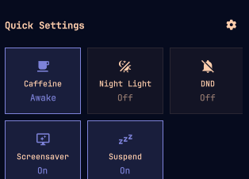
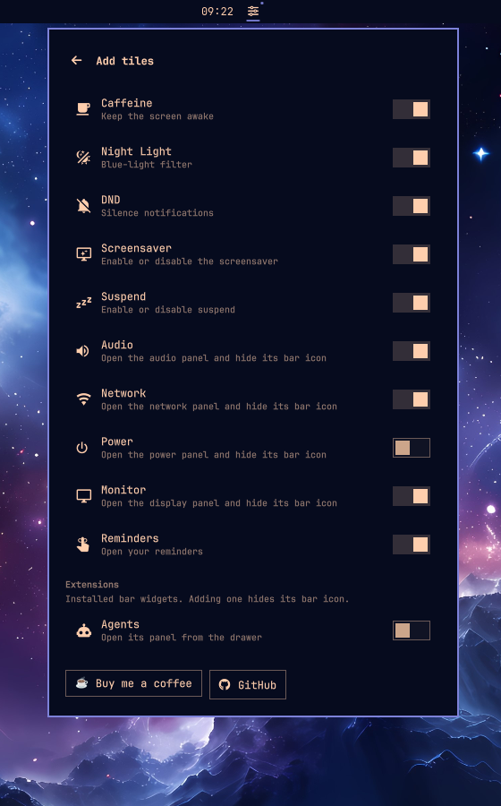

# Quick Drawer

A quick-toggle drawer for the [Omarchy](https://omarchy.org) bar.





Quick Drawer puts the things you reach for all day — caffeine, night light,
do-not-disturb, screensaver and suspend — behind one bar mark. Add panel
shortcuts, installed extensions and your own command tiles from the catalogue.

> This is a clone of Omarchy's `omarchy.indicators` widget. The clone keeps
> the source-specific first-party service access, so the service-backed
> toggles work without shelling out and polling.

## Features

- One sliders mark in any bar section.
- A card that opens under the widget's bar slot and stays on screen.
- Service-backed **Caffeine**, **Night Light** and **DND** toggles.
- **Screensaver**, **Suspend** and **Touchpad** flag toggles.
- Panel shortcuts for **Audio**, **Network**, **Power** and **Monitor**.
  Enabling one hides its bar icon and opens the panel from the drawer.
- **Reminders** opens the reminder flow.
- **Extensions** catalogue: installed first-party and third-party bar widgets
  can move into the drawer, hiding their bar icons.
- **Add tiles** view with a catalogue and switches.
- **Drag to reorder** tiles; the order is saved in `shell.json`.
- **Custom command tiles**: label, Nerd Font glyph and a `bash -lc` command.
- Selections persist in `shell.json` and survive shell restarts.
- Touchpad disappears when the machine has no touchpad.
- A small accent dot means one of Caffeine, Night Light or DND is on.

## Requirements

- Omarchy 4.x with the Quickshell shell.
- A Nerd Font set as the bar's font (the mark and tile glyphs need it).
- Omarchy's bundled CLI helpers (`omarchy`, `omarchy-toggle-*`,
  `omarchy-reminder`). No extra packages, accounts, telemetry or background
  network services are used.

## Install

```bash
omarchy plugin add https://github.com/KaplanHalil/omarchy-quick-drawer.git --enable
```

The widget replaces the stock `omarchy.indicators` entry where it sits in the
bar (center by default). If you want to move it:

```bash
omarchy bar move io.github.kaplanhalil.quickdrawer --section center
```

## Use

- Left-click the sliders mark to open the drawer.
- Click outside to close it.
- Click the gear in the drawer header to open **Add tiles**.
- Use the switches to add or remove tiles.
- Drag one tile onto another to reorder the grid. The new order is written
  back to `shell.json` and survives shell restarts.
- **Add custom command** creates a tile with your own label, glyph and
  command. The command runs with `bash -lc` as your user.

### Default tiles

| Tile | What it does |
| --- | --- |
| Caffeine | Stay awake (`omarchy.idle` `stayAwake`) |
| Night Light | Blue-light filter (`omarchy.nightlight`) |
| DND | Notification silencing (`omarchy.notifications`) |
| Screensaver | Enables/disables the screensaver (`screensaver-off` flag) |
| Suspend | Enables/disables suspend (`suspend-off` flag) |

### Catalogue

Audio, Network, Power, Monitor, Reminders, Touchpad, and the five default
tiles.

### Panels move into the drawer

When you enable **Audio**, **Network**, **Power** or **Monitor**, Quick Drawer
hides that widget's bar icon and opens the panel from the Quick Drawer mark
instead. The first-party panel is kept alive, so PipeWire, Wi-Fi, brightness
and the rest keep working exactly as before.

- The panel opens below the Quick Drawer mark.
- Removing the tile restores the bar icon in its original slot.
- The bar icon is hidden at runtime, not removed from `shell.json`.
- Power is hidden automatically on machines without a battery.
- Touchpad is hidden automatically on machines without a touchpad.
- If the panel widget is missing from the bar, the tile falls back to normal
  behaviour instead of hiding an icon it cannot open.

### Extensions move into the drawer

The **Extensions** section of Add tiles lists installed bar widgets that are
currently live in the bar, both first-party and third-party. Adding one hides
its bar icon and puts a tile in Quick Drawer.

Two modes are used:

- **Panel mode** — the extension has a panel. The panel opens below the Quick
  Drawer mark, with the extension's own services and data intact. Examples:
  Gazette, Omapop, Clock, Weather, Agents, Notification Center, TopStats.
- **Action mode** — the extension has no anchorable panel. Clicking the tile
  triggers the extension's primary bar button. Examples: OmaSettings,
  Keyboard layout, System update, Omarchy menu.

The extension list is refreshed whenever the drawer or Add tiles opens. Only
widgets that are currently in the bar can be listed; an installed but unplaced
plugin has no live widget to move.

Not every widget is a good single tile. The following are excluded:

- Advanced Workspaces and Pocket
- the system tray and spacer
- the core Audio, Network, Power and Monitor widgets, which already have
  dedicated tiles

Extensions are not re-instantiated inside the card. Panel mode reuses the real
panel; action mode triggers the real bar button. This is what keeps services
and state working, at the cost of not showing a live mini-widget inside the
card.

Removing an extension tile restores its bar icon in the original slot.

## IPC

The IPC target stays `omarchy.indicators` so the clone routing keeps working.

```bash
omarchy-shell omarchy.indicators open
omarchy-shell omarchy.indicators close
omarchy-shell omarchy.indicators toggle
omarchy-shell omarchy.indicators openSettings
omarchy-shell omarchy.indicators openGrid
omarchy-shell omarchy.indicators toggleCaffeine
omarchy-shell omarchy.indicators toggleNightLight
omarchy-shell omarchy.indicators toggleDnd
omarchy-shell omarchy.indicators toggleScreensaver
omarchy-shell omarchy.indicators toggleSuspend
omarchy-shell omarchy.indicators addTile audio
omarchy-shell omarchy.indicators removeTile audio
omarchy-shell omarchy.indicators openPanel audio
omarchy-shell omarchy.indicators addTile ext:io.github.kaplanhalil.gazette
omarchy-shell omarchy.indicators removeTile ext:io.github.kaplanhalil.gazette
omarchy-shell omarchy.indicators openPanel ext:io.github.kaplanhalil.gazette
omarchy-shell omarchy.indicators extensionStatus
```

## Custom commands

Custom commands are powerful and run unsandboxed:

```bash
notify-send 'Quick Drawer' 'The custom tile ran'
```

Only add commands you trust. The drawer shows the same warning in the form.

## Remove

```bash
omarchy plugin remove io.github.kaplanhalil.quickdrawer
```

This restores the stock `omarchy.indicators` widget in the same slot and
unhides any bar icons that panel or extension tiles had moved into the drawer.

## Support

If Quick Drawer is useful to you:

[☕ Buy me a coffee](https://www.buymeacoffee.com/kaplanhalil)

## Credits

- Derived from Omarchy's `omarchy.indicators` widget
  ([basecamp/omarchy](https://github.com/basecamp/omarchy), MIT).
- Built for the Omarchy 4.x Quickshell shell.

## License

MIT — see [LICENSE](LICENSE).
